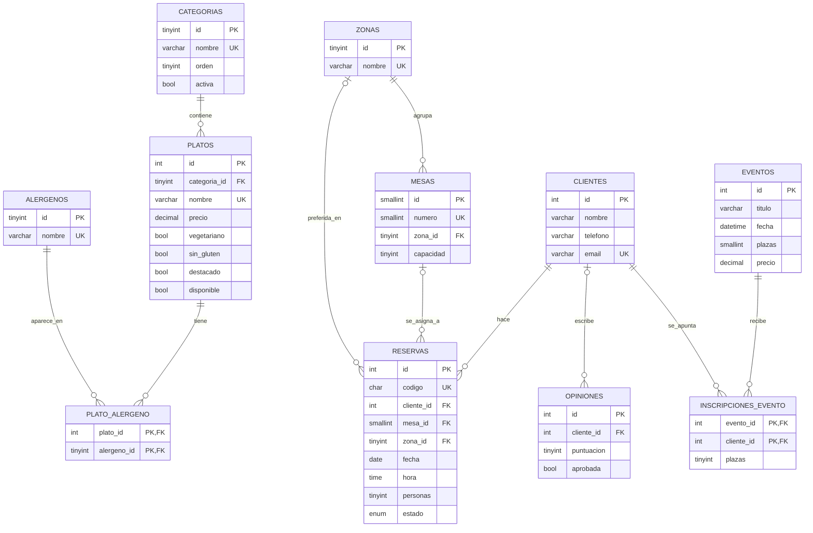

# Base de datos · Sabor Mediterráneo

Base de datos `sabor_mediterraneo` (MySQL / MariaDB en XAMPP). Script completo en [`restaurante.sql`](restaurante.sql).

## Cómo instalarla

1. Abre XAMPP y arranca **Apache** y **MySQL**.
2. Entra en <http://localhost/phpmyadmin>.
3. Pestaña **Importar** → selecciona `database/restaurante.sql` → **Continuar**.
4. Comprueba que aparece la base `sabor_mediterraneo` con 16 tablas, 3 vistas, 1 función, 1 procedimiento y 1 trigger.

## Diagrama entidad-relación



Tablas sin relaciones (configuración y gestión): `horarios`, `dias_cerrados`, `servicios`, `mensajes_contacto`, `usuarios`.

## Tablas

| Tabla | Para qué sirve |
|---|---|
| `categorias` | Secciones de la carta (Entrantes, Arroces…). |
| `platos` | Cada plato con precio, foto y etiquetas de dieta. |
| `alergenos` | Los 14 alérgenos obligatorios por ley (Reglamento UE 1169/2011). |
| `plato_alergeno` | Tabla intermedia N:M: qué alérgenos lleva cada plato. |
| `zonas` | Salón, terraza y reservado. |
| `mesas` | Mesas físicas, su zona y su capacidad. |
| `horarios` | Apertura y cierre por día de la semana y turno. |
| `dias_cerrados` | Festivos y vacaciones. |
| `clientes` | Datos de contacto de quien reserva (email único). |
| `reservas` | Fecha, hora, personas, estado y mesa asignada. |
| `servicios` | Menú del día, celebraciones, catas, para llevar. |
| `eventos` / `inscripciones_evento` | Eventos con plazas limitadas y quién se apunta. |
| `opiniones` | Reseñas; solo se publican las `aprobada = 1`. |
| `mensajes_contacto` | Mensajes del formulario de contacto. |
| `usuarios` | Personal con acceso al panel (contraseña cifrada con bcrypt). |

## Decisiones de diseño (para defender en la exposición)

- **Normalización (3FN).** Los alérgenos no se guardan como texto dentro de `platos`, sino en una tabla aparte unida con `plato_alergeno`. Así no se repiten datos y se puede filtrar por alérgeno.
- **Integridad referencial.** Todas las relaciones tienen `FOREIGN KEY` con reglas `ON DELETE` pensadas: si se borra una mesa, la reserva no se pierde (`SET NULL`); no se puede borrar una categoría que tenga platos (`RESTRICT`).
- **Restricciones `CHECK`.** Precio no negativo, puntuación de 1 a 5, personas de 1 a 20, un plato vegano tiene que ser vegetariano.
- **Estados con `ENUM`.** La reserva pasa por `pendiente → confirmada → completada` (o `cancelada` / `no_presentado`).
- **Seguridad.** Las contraseñas se guardan como hash (`password_hash` de PHP), nunca en claro. Desde PHP se usarán consultas preparadas (PDO) para evitar inyección SQL.
- **Lógica en la base de datos.**
  - `fn_mesas_libres(fecha, hora, personas)` cuenta las mesas libres, suponiendo que cada reserva ocupa la mesa 90 minutos.
  - `sp_asignar_mesa(id_reserva)` asigna la mesa más ajustada al grupo, priorizando la zona que eligió el cliente.
  - `trg_reservas_validar` impide reservar en fechas pasadas o días cerrados.
- **Vistas.** `vista_carta`, `vista_reservas_hoy` y `vista_ocupacion_diaria` simplifican las consultas de la web y del panel.

## Consultas de ejemplo

```sql
-- Carta completa con alérgenos
SELECT * FROM vista_carta;

-- ¿Hay mesa mañana a las 14:00 para 4?
SELECT fn_mesas_libres(CURRENT_DATE + INTERVAL 1 DAY, '14:00', 4);

-- Confirmar una reserva pendiente asignándole mesa
CALL sp_asignar_mesa(3);

-- Platos aptos para un celíaco vegetariano
SELECT nombre, precio FROM platos WHERE sin_gluten = 1 AND vegetariano = 1;

-- Precio medio por categoría
SELECT c.nombre, COUNT(p.id) AS platos, ROUND(AVG(p.precio), 2) AS precio_medio
FROM categorias c LEFT JOIN platos p ON p.categoria_id = c.id
GROUP BY c.id, c.nombre;
```
